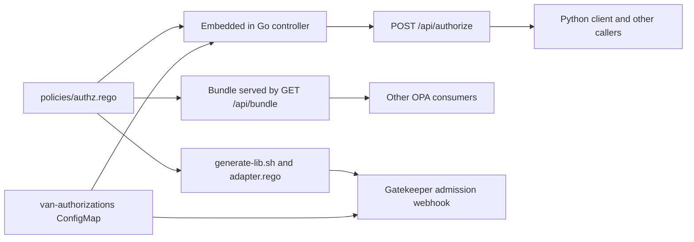

# Using OPA policies in distributed applications

This guide explains the ways to use Open Policy Agent (OPA) policies that this
project exercises, compares them, and draws lessons for the Skupper projects.

The project checks Skupper `Listener` and `Connector` resources against one Rego
policy. The same policy is used in three ways:

1. Embedded in a Go process (the controller).
2. Exposed over HTTP, as a decision API and as an OPA bundle.
3. Enforced at the Kubernetes API server by Gatekeeper.

Sections 1 to 3 describe what the code in this repository does. Section 5
(other methods) is not exercised here. It comes from the upstream OPA
documentation and is marked as such.

For commands, endpoints and observed output, see the [`README.md`](README.md)
and [`samples/gatekeeper/README.md`](samples/gatekeeper/README.md). This guide
does not repeat them.

## 0. The shared core: one policy and one data contract

All approaches reuse the same two things. This is the main design decision of
the project.

**The policy** is [`policies/authz.rego`](policies/authz.rego), package
`interconnect.authz`. It has three outputs:

- `allowed`, a boolean that defaults to `false`.
- `violations`, a set of messages.
- `permitted_keys`, the patterns that apply to the resource type.

**The input** is flat:

| Field         | Meaning                                         |
|---------------|-------------------------------------------------|
| `namespace`   | Namespace of the Skupper resource.              |
| `type`        | `Connector` or `Listener`.                      |
| `routing_key` | `spec.routingKey` of the resource.              |

**The data** is `data.authorizations`, shaped as
`{ "<namespace>": { "provides": [...], "requires": [...] } }`. A `Connector` is
checked against `provides` and a `Listener` against `requires`. Each entry is a
glob pattern.

The source of the data is a ConfigMap, `van-authorizations`, key
`authorizations.json`. The policy does not know where the data comes from. Each
approach below only differs in how it gets the policy, the data and the input
to the same place, and in what it does with the answer.

## 1. Approach 1: embedded in a Go process

### How it works

The controller compiles the policy into its own process and evaluates it in
memory.

- [`embed.go`](embed.go) embeds `policies/*.rego` into the binary with
  `//go:embed`.
- [`internal/validator/validator.go`](internal/validator/validator.go) reads the
  embedded files (skipping `_test.rego`), compiles them once with
  `PrepareForEval` and keeps an in-memory OPA store. `UpdateData` replaces
  `/authorizations` in that store under a mutex. `Evaluate` runs the prepared
  query `data.interconnect.authz`.
- [`internal/configmapwatcher/watcher.go`](internal/configmapwatcher/watcher.go)
  watches the `van-authorizations` ConfigMap with an informer and calls
  `UpdateData` when it changes.
- [`internal/controller/controller.go`](internal/controller/controller.go) watches
  `Listener` and `Connector` resources in all namespaces, builds the input,
  evaluates it, and stores the result in
  [`internal/cache/cache.go`](internal/cache/cache.go). After each data update,
  `ReevaluateAll` evaluates every known resource again.
- [`internal/server/server.go`](internal/server/server.go) shows the cached
  results as HTML and JSON.

The controller reports only. It never blocks or changes a resource.

### Benefits

- No network hop. A decision is a function call into a prepared query.
- Policy and code ship together. The policy version is the binary version, and
  the policy is covered by the same build and image scan.
- Data changes apply without a restart. The watcher reloads data and
  re-evaluates everything.
- Simple failure model for the policy itself: it cannot be unreachable.
- The whole behaviour can be unit tested in Go next to the policy tests in
  [`policies/authz_test.rego`](policies/authz_test.rego).

### Burdens

- Only Go code can use it. Other languages need approach 2 or a different method.
- Only code inside this module can read the policy files, because `embed.FS`
  is private to the module. Sharing needs another channel (this is why the bundle
  endpoint exists).
- A policy change needs a new build and image rollout.
- OPA becomes a Go dependency (`github.com/open-policy-agent/opa` v1.21.3 in
  [`go.mod`](go.mod)). The application owns its upgrades.
- The application owns the plumbing: loading data, locking around updates,
  and deciding what to do when data is missing or invalid. The code here keeps
  the last good data when the ConfigMap is deleted, has no `authorizations.json`
  key, or contains invalid JSON. It starts with empty data, which denies
  everything.
- State lives in memory and is rebuilt at start, so the README requires a
  single replica.

## 2. Approach 2: policies as a service (decision API and bundle)

The controller process from approach 1 also exposes the policy to other
applications. There are two different things on offer, and they solve different
problems.

### 2.1 Ask for a decision: `POST /api/authorize`

The caller sends `namespace`, `type` and `routing_key`. The service evaluates
the embedded policy with its current data and answers
`{"allowed": ..., "violations": [...]}`. A denial is a normal `200`. Bad
requests are `400` and evaluation failures are `500`, both as plain text. The
handler is in [`internal/server/server.go`](internal/server/server.go).

[`samples/python/check_authorization.py`](samples/python/check_authorization.py)
is the example consumer. It uses only the Python standard library, reads the
service address from `OPA_AUTHZ_URL`, uses a 10 second timeout, accepts only
`http` and `https` URLs, and maps the answer to exit codes (`0` allowed, `3`
denied, `1` service problem, `2` invalid configuration).

This is a custom API of the project. It is not the OPA REST API, so callers
depend on this contract and not on a standard.

**Benefits**

- Works from any language with an HTTP client. The Python sample needs no
  packages.
- One place holds the policy and the data. A change is visible to all callers at
  once.
- Callers get the same decision and the same message as the controller.
- Callers need no OPA knowledge and no Rego tooling.

**Burdens**

- The service is now a runtime dependency. It runs as one replica with in-memory
  state, so it is a single point of failure.
- Every decision costs a network round trip, and the caller must handle
  timeouts. The Python sample treats an unreachable service as an error (exit
  `1`), not as allowed or denied. Each caller has to choose fail-open or
  fail-closed.
- Each caller must build the right input. Typos in `type` or `routing_key` are
  caller errors that the service can only reject.
- The sample API has no authentication and no TLS. `PUT /api/authorizations`
  changes the policy data, and the Service is a `LoadBalancer`. The README lists
  this under "Evaluation limits". The container listens on `0.0.0.0:8080` by
  default. This is acceptable for a short evaluation only. Before real use, use
  a `ClusterIP` Service, TLS 1.2 or higher and authentication.

### 2.2 Take the policy: `GET /api/bundle`

The endpoint returns the policies as a standard OPA bundle (gzipped tarball).
`buildBundle` in [`internal/server/server.go`](internal/server/server.go)
builds it from the embedded files. Details:

- It contains policies only, no `_test.rego` files and no data.
- The manifest claims the root `interconnect`. The policy lives in that
  package, and `data.authorizations` stays outside the bundle. The consumer
  keeps ownership of its own data.
- The consumer supplies `data.authorizations` in the same shape and evaluates
  `data.interconnect.authz`.

**Benefits**

- The consumer evaluates locally. There is no per-decision network call, and no
  dependency on this service for each decision.
- The consumer can use its own data source, and the policy still comes from one
  place.
- It uses OPA's standard format. The upstream OPA documentation describes OPA
  downloading bundles from an HTTP service on a schedule (see section 5).

**Burdens**

- The consumer needs OPA (the Go SDK, an OPA process, or another runtime) and
  must supply and update the data.
- The endpoint is a minimal implementation. The OPA documentation says bundle
  services should set an `ETag` header so that clients can send
  `If-None-Match`. This handler does not set it (it was left out of scope in
  [`opa-bundle-endpoint-plan.md`](opa-bundle-endpoint-plan.md)). The bundle is
  also unsigned, and the endpoint has the same authentication and TLS gaps as
  the rest of the API.
- Policy and data can drift. A consumer can run a new policy with old data, or
  the reverse. The shared contract is only a convention.

## 3. Approach 3: Kubernetes admission control with Gatekeeper

### How it works

Gatekeeper is an admission webhook that evaluates Rego for each create or
update request. The controller only reports. This approach rejects the request.
The files are in [`samples/gatekeeper`](samples/gatekeeper).

The policy cannot be used unchanged inside Gatekeeper:

- A template can read only `data.inventory` and `data.lib.*`, and its input is
  an AdmissionReview, not the flat input.
- [`generate-lib.sh`](samples/gatekeeper/generate-lib.sh) rewrites
  `policies/authz.rego` with `sed`: the package becomes `lib.interconnect.authz`,
  `data.authorizations` becomes `input.authorizations`, and `import rego.v1`
  becomes `import future.keywords`. It fails if the expected text is not there,
  so a policy edit cannot silently produce a wrong lib.
- [`adapter.rego`](samples/gatekeeper/adapter.rego) is the only
  Gatekeeper-specific code. It reads the ConfigMap from the Gatekeeper
  inventory, parses the JSON, builds the flat input and calls the lib with
  `with input as`. Each lib message becomes one Gatekeeper violation.
- [`gatekeeper-config.yaml`](samples/gatekeeper/gatekeeper-config.yaml) is a
  `Config` CR that makes Gatekeeper sync ConfigMaps into its inventory.
- [`apply-policies.sh`](samples/gatekeeper/apply-policies.sh) builds the
  `ConstraintTemplate`, applies the Config, the template and the Constraint, and
  accepts `ENFORCEMENT_ACTION` (`deny`, `warn`, `dryrun`).
- [`install-gatekeeper.sh`](samples/gatekeeper/install-gatekeeper.sh) installs a
  pinned release (default `v3.23.1`, set with `GATEKEEPER_VERSION`) from the
  upstream release manifest, and waits for the CRDs and deployments.

### Benefits

- Real enforcement. The sample observed an invalid `Connector` and `Listener`
  being rejected with the same text the controller reports.
- Nothing to call. Any client, `kubectl`, GitOps tools or other controllers go
  through the API server, so no caller can skip the check.
- Staged rollout: `dryrun` records violations without blocking, `warn` shows
  them to the client, `deny` enforces. The sample observed all three.
- Audit reports resources that already existed before the policy. In the
  `dryrun` test, four of five reported violations were such resources.
- Data changes need no re-apply. Editing the ConfigMap changed decisions in the
  sample after a short delay.
- The policy is still a single file. The adapter is about 50 lines and there is
  no second copy of the logic.

### Burdens

All of these are in the sample's "Known limits" section or in the files above.

- Fail-open by default. The upstream manifest installs the webhook with
  `failurePolicy: Ignore`. With the controller manager scaled to zero, the
  connector that was denied before was created. Gatekeeper documents how to fail
  closed, with risks. The sample does not change it.
- Gatekeeper must be installed, upgraded and operated on every cluster, with
  cluster-admin rights, CRDs, cluster roles and webhook configurations. The
  sample used the upstream image `openpolicyagent/gatekeeper`, not an image
  from `registry.redhat.io`. For production, mirror and scan it.
- The `Config` CR syncs every ConfigMap in the cluster, because `syncOnly`
  selects a kind and not a name. That costs memory on clusters with many
  ConfigMaps. `Config` is a singleton, so applying the sample can change an
  existing one.
- The synced data is eventually consistent. A request right after an edit can see
  old data.
- Anyone who can edit the ConfigMap changes the decisions. Restrict access to it.
- The policy is changed by text rewriting. This works because the policy is
  small and `generate-lib.sh` checks its result, but a larger policy (new
  imports, other `data.` references) may need a better mechanism.
- The Rego dialect is different from the one in the repo (`future.keywords`
  instead of `rego.v1`), so the policy must be tested again inside Gatekeeper.
- Only new and updated requests are checked. Existing resources are only
  reported by audit.
- Only `Listener` and `Connector` of `v2alpha1` are matched.
- Mutation and expansion do not apply here. The sample README explains why,
  with references to the Gatekeeper documentation.

### One difference between the controller and Gatekeeper

The sample README says the Gatekeeper adapter matches the controller. This holds
for decisions and messages. From reading the code, behaviour differs when the
data becomes bad after it was good:

| Event                                      | Controller (`watcher.go`)                  | Gatekeeper (`adapter.rego`)                      |
|--------------------------------------------|---------------------------------------------|--------------------------------------------------|
| ConfigMap never existed                    | Empty data, deny all.                       | Empty data, deny all.                            |
| ConfigMap deleted                          | Keeps the last loaded data.                 | Inventory entry is gone, so empty data, deny all.|
| `authorizations.json` key removed          | Skips the update, keeps the last data.      | Empty data, deny all.                            |
| `authorizations.json` is invalid JSON      | Keeps the last data.                        | `json.unmarshal` fails, so empty data, deny all. |

This comparison comes from the code, it was not tested on a cluster. It shows
that a shared policy does not give shared failure behaviour. See the lessons.

## 4. Side-by-side comparison

| Criterion                | 1. Embedded (Go)                      | 2a. Decision API                      | 2b. Bundle                              | 3. Gatekeeper                           |
|--------------------------|----------------------------------------|----------------------------------------|------------------------------------------|------------------------------------------|
| Where the decision runs  | In the application process.            | In the controller, over HTTP.          | In the consumer, with its own OPA.       | In the Gatekeeper pods, at admission.    |
| Who can consume it       | Go code in this module.                | Any HTTP client.                       | Anything that can run OPA.               | Any client of the Kubernetes API.        |
| Effect of a denial       | Reported, nothing is blocked.          | Caller decides.                        | Consumer decides.                        | Request rejected (`deny`), or warned.    |
| Data source              | ConfigMap watched by the app.          | Same ConfigMap, via the controller.    | Chosen by the consumer.                  | ConfigMap synced into the inventory.     |
| Latency per decision     | Function call.                         | Network round trip.                    | Function call.                           | One admission webhook call per request.  |
| If the policy source fails | Not applicable, policy is in the binary. | Caller must handle it. | Consumer keeps what it has loaded.       | Fail-open by default (observed).         |
| Policy update path       | New image.                             | New image of the controller.           | New bundle download.                     | Re-run `apply-policies.sh`.              |
| Data update path         | Edit ConfigMap, reloaded.              | Edit ConfigMap or `PUT /api/authorizations`. | Consumer's own.                    | Edit ConfigMap, eventually synced.       |
| Extra moving parts       | None beyond the app.                   | The controller as a service.           | OPA in each consumer.                    | Gatekeeper, CRDs, webhook, audit.        |
| Language coupling        | Go.                                    | None.                                  | OPA runtime availability.                | None, Kubernetes only.                   |
| Security state in this repo | The evaluation itself is local. The controller's HTTP server has the gaps listed for 2a. | No authentication or TLS in the sample. | Same as 2a, plus unsigned and no `ETag`. | Upstream image, sync scope and RBAC on the ConfigMap need review. |
| Main operational burden  | Own the OPA dependency and data plumbing. | Run and secure a service.           | Distribute policy and data in step.      | Operate Gatekeeper, choose failure policy. |

The approaches answer different questions. Approach 1 and 2b answer "how do I
evaluate the policy in my code". Approach 2a answers "how does a program that
is not OPA-aware ask". Approach 3 answers "how do I stop a bad resource from
entering the cluster".

## 5. Other methods (not exercised in this repository)

This table comes from the upstream OPA documentation at
`https://www.openpolicyagent.org/docs` (pages "Integrating OPA", "Bundles",
"WebAssembly", "External Data" and "OPA-Envoy Plugin", read for this guide). No
code in this repository uses these methods. Treat them as options to evaluate,
not as tested results.

| Method | How it works | Fits when | Main burden |
|--------|--------------|-----------|-------------|
| OPA as a daemon or sidecar with its REST API | OPA runs next to the application, on the same host or in the same pod, and the application queries it over HTTP. | Non-Go applications that want a low-latency local decision. | One more process per workload to deploy and update. |
| OPA bundle polling (Bundle API) | OPA downloads policy (and optionally data) bundles from an HTTP service on a schedule. Services should return an `ETag`. Bundles can be signed with `opa build`. | Many OPA instances that must follow one policy source. The `GET /api/bundle` endpoint here is a starting point. | A bundle service to run, plus staleness between a publish and a download. |
| OPA Go SDK | `sdk.New` loads configuration and policy (from a bundle server or from files) and exposes a `Decision` call inside a Go program. | Go components that want OPA-managed bundle loading, without writing their own plumbing like `validator.go`. | The same Go dependency as approach 1. |
| Compile to Wasm | `opa build -t wasm` produces a module that any Wasm runtime can evaluate. SDKs exist for several languages. | Embedding in non-Go runtimes with no OPA process. | Not all Rego built-ins are supported, and the host owns loading and data. |
| OPA-Envoy plugin | OPA runs a gRPC server that implements the Envoy External Authorization API. | Authorising network traffic through Envoy at the proxy. | Needs Envoy, and the input is the Envoy request, not the Skupper resource. |
| External data patterns (input, bundle, push) | The documentation lists ways to give OPA data: send it in `input`, replicate it in bulk by bundle, or push it with the data API. | Choosing how `data.authorizations` reaches OPA when it is not a ConfigMap. | Each has a freshness and size trade-off, described in the page. |
| Policy tests in CI | `opa test` runs the Rego tests. This repo already has [`policies/authz_test.rego`](policies/authz_test.rego) and [`samples/gatekeeper/adapter_test.rego`](samples/gatekeeper/adapter_test.rego). | Always. It is the cheapest control. | None beyond keeping tests current. |

## 6. Lessons learned

Each lesson points to the evidence in this repository.

1. **Keep one policy file and derive the rest from it.** The Gatekeeper lib is
   generated from [`policies/authz.rego`](policies/authz.rego), so there is no
   second copy. The generator fails when its expected text is missing
   ([`generate-lib.sh`](samples/gatekeeper/generate-lib.sh)).
2. **Define the contract before the integrations.** The input fields and the
   data shape were reused unchanged by the controller, the API, the bundle and
   the adapter. Changing either now would touch all four.
3. **Make decisions read the same everywhere.** The controller, the API and the
   webhook return the same text. The sample README shows the same messages for
   the same inputs. This helps users and makes tests comparable.
4. **Specify failure behaviour in each channel, not only in the policy.** The
   policy is shared, but the controller keeps stale data on a bad update while
   Gatekeeper denies everything (section 3). Decide it once, document it, and
   test it in every channel.
5. **Test in each runtime.** Gatekeeper needed `import future.keywords`, and a
   bug (an empty `routingKey` defaulted to the resource name in the adapter,
   unlike the controller) was found only on a real cluster. It is recorded in
   [`gatekeeper-sample-plan.md`](gatekeeper-sample-plan.md). `opa test` over the
   policy and adapter tests passes, but it is not a substitute for a cluster run.
6. **Report first, enforce later.** The controller reports. Gatekeeper has
   `dryrun`, `warn` and `deny`. Starting with reporting shows the real impact,
   including on resources that already exist, before anything is blocked.
7. **Choose fail-open or fail-closed on purpose.** The Gatekeeper default is
   fail-open (observed), and the decision API pushes the choice to every caller.
   Neither is a default to accept by accident.
8. **Separate policy distribution from data distribution.** The bundle carries
   policy under the `interconnect` root and no data, so consumers own their
   data. This avoids shipping one team's authorizations to everyone.
9. **Whoever can edit the data controls the policy.** The ConfigMap and
   `PUT /api/authorizations` decide the outcome, and the sample API has no
   authentication. Treat access to the data with the same care as access to the
   policy.
10. **Pin and review versions.** The sample pins Gatekeeper `v3.23.1` and OPA
    `v1.21.3`. The deployment manifest uses the `latest` tag with
    `imagePullPolicy: Always`, which the README says to replace for repeatable
    deployments.
11. **Count the cost of the shared cache.** Syncing every ConfigMap into
    Gatekeeper is a convenience of the sample. Option B (data in Constraint
    parameters) removes it, but it was documented only, not implemented or
    tested.
12. **A small policy hides the scaling problems.** The `sed` rewrite and the
    inventory sync work because the policy is one file with one data reference.
    Re-check both when the policy grows.

## 7. Recommendation for the Skupper projects

The recommendation uses what this repository showed, and states where it goes
beyond it.

1. **Make the policy and its data contract the product.** Keep one Rego source
   per concern, version it, test it with `opa test` in CI, and publish it as an
   OPA bundle. Keep the input and data shapes stable and documented. This is
   what every approach here depended on.
2. **Enforce at the API server with Gatekeeper where a bad resource must not
   enter the cluster.** Generate the Gatekeeper lib from the same Rego source,
   as this sample does. Roll out with `dryrun`, then `warn`, then `deny`. Set
   the webhook failure policy deliberately, and mirror and scan the Gatekeeper
   image from an approved registry. Review the ConfigMap sync scope before
   production, and evaluate option B for the data.
3. **Embed OPA inside Skupper Go components that need runtime decisions.** Use a
   single loading path for policy and data, and the same failure rules as the
   admission path (fixing the difference in section 3 first). For the policy
   source, prefer a signed, versioned bundle over a copy of the file, and
   evaluate the OPA Go SDK to avoid maintaining the plumbing in `validator.go`.
4. **Keep the decision API for tools and non-Go clients, off the critical
   path.** It is good for a CLI, a UI or a check in a pipeline. Do not put it
   between a data plane and its traffic. If that is ever needed, use Wasm or a
   local OPA instead of a remote call.
5. **Do not take the sample controller to production as is.** Before it holds
   real policy data it needs authentication, TLS 1.2 or higher, a `ClusterIP`
   Service, an `ETag` and signing on the bundle, an HA story beyond a single
   replica, and a loopback or internal bind address instead of `0.0.0.0`.

Proposals 3 to 5 go beyond what this repository demonstrates. Points 1 and 2
are directly supported by it.

### Questions Skupper must answer

- Where does the authorization data live, and who may edit it?
- Should admission fail open or closed when Gatekeeper is down?
- How are policies versioned, signed and rolled back?
- Do any non-Go components need the policy, and is a service call acceptable for
  them, or do they need Wasm?
- Which behaviour should apply when the data is deleted or invalid (see the
  difference table in section 3)?

## 8. Where to look in this repository

| Topic                         | File                                                                                  |
|-------------------------------|----------------------------------------------------------------------------------------|
| The policy and its tests      | [`policies/authz.rego`](policies/authz.rego), [`policies/authz_test.rego`](policies/authz_test.rego) |
| Embedding                     | [`embed.go`](embed.go), [`internal/validator/validator.go`](internal/validator/validator.go) |
| Data loading                  | [`internal/configmapwatcher/watcher.go`](internal/configmapwatcher/watcher.go)         |
| Resource evaluation           | [`internal/controller/controller.go`](internal/controller/controller.go)               |
| HTTP API and bundle           | [`internal/server/server.go`](internal/server/server.go)                               |
| Non-Go client                 | [`samples/python/check_authorization.py`](samples/python/check_authorization.py)       |
| Gatekeeper sample             | [`samples/gatekeeper/README.md`](samples/gatekeeper/README.md)                         |
| Gatekeeper install            | [`samples/gatekeeper/install-gatekeeper.sh`](samples/gatekeeper/install-gatekeeper.sh) |
| Gatekeeper adapter and lib    | [`samples/gatekeeper/adapter.rego`](samples/gatekeeper/adapter.rego), [`samples/gatekeeper/generate-lib.sh`](samples/gatekeeper/generate-lib.sh) |
| Design history                | [`gatekeeper-sample-plan.md`](gatekeeper-sample-plan.md), [`opa-bundle-endpoint-plan.md`](opa-bundle-endpoint-plan.md) |
