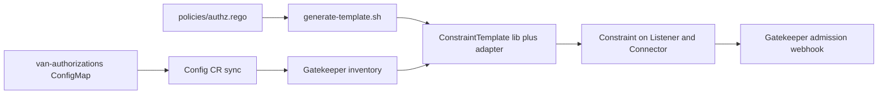

# Gatekeeper sample

This sample uses [OPA Gatekeeper](https://open-policy-agent.github.io/gatekeeper)
as a Kubernetes admission controller. It rejects the creation of Skupper
`Listener` and `Connector` resources that the authorization policy does not
allow. The controller in the repository root only reports on resources. This
sample blocks them at the API server.

The decision uses the same data and the same Rego as the controller:

- Data: the `van-authorizations` ConfigMap, key `authorizations.json`, in the
  shape `{ns: {provides: [], requires: []}}`.
- Policy: [`policies/authz.rego`](../../policies/authz.rego). It is the single
  source of truth. The sample does not keep a copy of it.

Because both use the same policy, a denial from the webhook has the same text as
a violation shown by the controller.

## How it works



Gatekeeper templates can read only `data.inventory` and `data.lib.*`, and their
input is an AdmissionReview. So the generated `ConstraintTemplate` has two
parts:

- A `libs` entry: `policies/authz.rego` rewritten by
  [`generate-lib.sh`](generate-lib.sh) to package `lib.interconnect.authz`, with
  `data.authorizations` replaced by `input.authorizations` and
  `import rego.v1` replaced by `import future.keywords`. The script fails if the
  expected text is not found, so a policy change cannot silently produce a wrong
  lib.
- A thin adapter, [`adapter.rego`](adapter.rego), the only Gatekeeper specific
  code. It reads the ConfigMap from
  `data.inventory.namespace[<ns>]["v1"]["ConfigMap"]["van-authorizations"]`,
  parses `authorizations.json`, builds the flat input (`namespace`, `type`,
  `routing_key`, `authorizations`) and calls the lib with `with input as`. Each
  message returned by the lib becomes one Gatekeeper violation.

The ConfigMap is made available to the template by a Gatekeeper `Config` CR
([`gatekeeper-config.yaml`](gatekeeper-config.yaml)) that syncs `v1/ConfigMap`
into the inventory. The namespace that holds the ConfigMap is a Constraint
parameter (`configmap_namespace`, default `opa-authorizations`).

Behaviour of the adapter:

- A missing ConfigMap, a missing `authorizations.json` key or invalid JSON means
  empty authorizations, so every resource is denied. This matches the
  controller ("until the ConfigMap exists, every resource is denied").
- `spec.routingKey` is used as is, like the controller does. The Skupper CRDs
  mark `routingKey` as required, but an empty string passes the API schema
  check. An empty routing key is evaluated as an empty string and denied
  (observed below).

## Files

| File                                    | Purpose                                                                 |
|-----------------------------------------|-------------------------------------------------------------------------|
| `generate-lib.sh`                       | Prints the lib generated from `policies/authz.rego`.                    |
| `generate-template.sh`                  | Builds the `ConstraintTemplate` YAML (lib plus `adapter.rego`).         |
| `adapter.rego`, `adapter_test.rego`     | Gatekeeper adapter and its tests.                                       |
| `gatekeeper-config.yaml`                | `Config` CR that syncs ConfigMaps into the inventory.                   |
| `skupper-authorization-constraint.yaml` | `Constraint` (kind `SkupperAuthorization`) for `Listener` and `Connector`. |
| `install-gatekeeper.sh`                 | Installs a pinned Gatekeeper release.                                   |
| `apply-policies.sh`                     | Applies the Config CR, the template and the Constraint.                 |
| `remove-policies.sh`                    | Removes the Constraint, the template and the Config CR.                 |
| `uninstall-gatekeeper.sh`               | Removes Gatekeeper, its CRDs and namespace.                             |
| `lib/authz.rego`                        | Generated by `generate-template.sh`. Do not edit.                       |

## Prerequisites

- A Kubernetes cluster and `kubectl` (or `oc`) with cluster-admin rights.
  Gatekeeper installs CRDs, cluster roles and webhook configurations.
- The Skupper v2 CRDs (`listeners.skupper.io` and `connectors.skupper.io`,
  `v2alpha1`).
- Internet access from the cluster nodes to pull the Gatekeeper image, and from
  your machine to download the release manifest.
- Optional: the OPA CLI, to run the tests (see below).

The scripts use `kubectl`, or `oc` if `kubectl` is not found. Set `KUBECTL` to
force a binary.

## Install Gatekeeper

```bash
samples/gatekeeper/install-gatekeeper.sh
```

The script applies the manifest of Gatekeeper `v3.23.1` over HTTPS and waits for
the CRDs and the `gatekeeper-controller-manager` and `gatekeeper-audit`
deployments. Set `GATEKEEPER_VERSION` to install another release (format
`vX.Y.Z`).

## Apply the policies

```bash
samples/gatekeeper/apply-policies.sh
```

Observed output:

```
Applying Gatekeeper Config CR (ConfigMap sync)...
config.config.gatekeeper.sh/config created
Generating and applying ConstraintTemplate (skupperauthorization)...
constrainttemplate.templates.gatekeeper.sh/skupperauthorization created
Waiting for SkupperAuthorization CRD to be established...
customresourcedefinition.apiextensions.k8s.io/skupperauthorization.constraints.gatekeeper.sh condition met
Applying SkupperAuthorization Constraint (enforcementAction=deny, configmap_namespace=opa-authorizations)...
skupperauthorization.constraints.gatekeeper.sh/skupper-authz created
Policies applied successfully.
```

Environment variables:

| Variable              | Values                       | Default              |
|-----------------------|------------------------------|----------------------|
| `ENFORCEMENT_ACTION`  | `deny`, `warn`, `dryrun`     | `deny`               |
| `CONFIGMAP_NAMESPACE` | a namespace name             | `opa-authorizations` |

The script is idempotent. Run it again with other values to change the mode.

The committed YAML files are not modified. The script patches the two values
into the Constraint while it applies it.

## Try it

This flow uses the data from the main README: `team-a` provides `orders` and
requires `inventory`. The ConfigMap in `opa-authorizations` must contain:

```json
{"team-a": {"provides": ["orders"], "requires": ["inventory"]}}
```

You can set it through the controller (`PUT /api/authorizations`, see the main
README) or create it yourself with `kubectl`. The output below was captured on a
kind cluster (Kubernetes v1.37.0) where the ConfigMap already held exactly this
data.

Create the namespace and the four resources:

```bash
kubectl create namespace team-a
```

`connector-orders.yaml`:

```yaml
apiVersion: skupper.io/v2alpha1
kind: Connector
metadata:
  name: orders
spec:
  routingKey: orders
  port: 8080
  selector: app=orders
```

`connector-secret.yaml`: the same, with name `secret`, `routingKey: secret` and
`selector: app=secret`.

`listener-inventory.yaml`:

```yaml
apiVersion: skupper.io/v2alpha1
kind: Listener
metadata:
  name: inventory
spec:
  routingKey: inventory
  port: 8080
  host: inventory
```

`listener-orders.yaml`: the same, with name `orders`, `routingKey: orders` and
`host: orders`.

```bash
for f in connector-orders connector-secret listener-inventory listener-orders; do
  echo "== $f"; kubectl -n team-a apply -f $f.yaml
done
```

Observed output:

```
== connector-orders
connector.skupper.io/orders created
== connector-secret
Error from server (Forbidden): error when creating "connector-secret.yaml": admission webhook "validation.gatekeeper.sh" denied the request: [skupper-authz] routing key 'secret' is not permitted for Connector in namespace 'team-a'
== listener-inventory
listener.skupper.io/inventory created
== listener-orders
Error from server (Forbidden): error when creating "listener-orders.yaml": admission webhook "validation.gatekeeper.sh" denied the request: [skupper-authz] routing key 'orders' is not permitted for Listener in namespace 'team-a'
```

- The `Connector` offers `orders`, which is in `provides`: allowed.
- The `Connector` offering `secret` is not in `provides`: denied.
- The `Listener` consuming `inventory` is in `requires`: allowed.
- The `Listener` consuming `orders` is not in `requires` (a listener is checked
  against `requires`, not `provides`): denied.

A namespace that is not in the data is denied with the other message. In a
namespace named `gk-team-x`, both the connector and the listener above gave:

```
Error from server (Forbidden): error when creating "connector-orders.yaml": admission webhook "validation.gatekeeper.sh" denied the request: [skupper-authz] namespace 'gk-team-x' not found in authorizations
```

A `Listener` with `routingKey: ""` is accepted by the Skupper schema but denied
by the policy:

```
Error from server (Forbidden): error when creating "listener-nokey.yaml": admission webhook "validation.gatekeeper.sh" denied the request: [skupper-authz] routing key '' is not permitted for Listener in namespace 'team-a'
```

### Same decisions as the controller

`POST /api/authorize` on the controller (through a port-forward) returned the
same messages for the same inputs:

```
team-a connector secret   {"allowed":false,"violations":["routing key 'secret' is not permitted for Connector in namespace 'team-a'"]}
team-a listener orders    {"allowed":false,"violations":["routing key 'orders' is not permitted for Listener in namespace 'team-a'"]}
gk-team-x connector orders {"allowed":false,"violations":["namespace 'gk-team-x' not found in authorizations"]}
team-a connector orders   {"allowed":true,"violations":[]}
```

### Change the data without re-applying anything

Gatekeeper reads the ConfigMap from its inventory, so a change takes effect
without touching the policies. To keep the controller ConfigMap untouched, this
test used a separate namespace `gk-cfg` for the ConfigMap and pointed the
Constraint at it once:

```bash
kubectl create namespace gk-cfg
kubectl -n gk-cfg create configmap van-authorizations \
  --from-literal=authorizations.json='{"team-a": {"provides": ["orders"], "requires": ["inventory"]}}'
CONFIGMAP_NAMESPACE=gk-cfg samples/gatekeeper/apply-policies.sh
```

Then, with only the ConfigMap changing (no `apply-policies.sh`), a 3 second
wait after each edit:

```
== before edit: connector 'secret' in team-a
Error from server (Forbidden): ... [skupper-authz] routing key 'secret' is not permitted for Connector in namespace 'team-a'
== edit ConfigMap: add "secret" to provides
configmap/van-authorizations configured
connector.skupper.io/secret created
== edit ConfigMap: remove "secret" again, delete the connector, create it again
configmap/van-authorizations configured
connector.skupper.io "secret" deleted from team-a namespace
Error from server (Forbidden): ... [skupper-authz] routing key 'secret' is not permitted for Connector in namespace 'team-a'
```

The sync is eventual. A request sent immediately after an edit may still see
the old data.

## Enforcement modes

Run `apply-policies.sh` again with `ENFORCEMENT_ACTION`, to observe before
enforcing. Observed with `connector-secret.yaml`:

`ENFORCEMENT_ACTION=warn`: the request is admitted and the client gets a warning.

```
Warning: [skupper-authz] routing key 'secret' is not permitted for Connector in namespace 'team-a'
connector.skupper.io/secret created
```

`ENFORCEMENT_ACTION=dryrun`: the request is admitted with no message to the
client. The violation is recorded on the Constraint by the audit. After waiting
75 seconds, `kubectl get skupperauthorization skupper-authz -o jsonpath='{.status.totalViolations}'`
returned `5`, and `.status.violations` listed, with `"enforcementAction":"dryrun"`:

```
Connector team-a/secret   routing key 'secret' is not permitted for Connector in namespace 'team-a'
Listener  west/backend    namespace 'west' not found in authorizations
Listener  east/frontend   namespace 'east' not found in authorizations
Connector west/frontend   namespace 'west' not found in authorizations
Connector east/backend    namespace 'east' not found in authorizations
```

Four of the five are resources that already existed in the cluster. Audit
also reports resources created before the policy, which the webhook never sees.

Apply again with the default (`deny`) to enforce:

```bash
samples/gatekeeper/apply-policies.sh
```

## Remove

```bash
samples/gatekeeper/remove-policies.sh      # Constraint, template, Config CR. Gatekeeper stays.
samples/gatekeeper/uninstall-gatekeeper.sh # Gatekeeper, its CRDs and namespace.
```

Observed output of `remove-policies.sh`:

```
Removing SkupperAuthorization Constraint...
skupperauthorization.constraints.gatekeeper.sh "skupper-authz" deleted
Removing ConstraintTemplate (skupperauthorization)...
constrainttemplate.templates.gatekeeper.sh "skupperauthorization" deleted
Removing Gatekeeper Config CR...
config.config.gatekeeper.sh "config" deleted from gatekeeper-system namespace
Policies removed successfully.
```

After this, creating `connector-secret.yaml` succeeded again. Running the script
a second time worked and printed no error. `uninstall-gatekeeper.sh` also
deletes the Constraint and template first (a template deletion removes the
Constraint CRD), then the release manifest. After it, the cluster had no
`gatekeeper-system` namespace, no Gatekeeper CRDs and no validating or mutating
webhook configurations, and the existing `opa-authorizations` resources were
unchanged.

Delete your test namespaces yourself (`kubectl delete namespace team-a gk-cfg`).

## Tests

```bash
opa test policies/ samples/gatekeeper/adapter.rego samples/gatekeeper/adapter_test.rego samples/gatekeeper/lib/authz.rego
```

`lib/authz.rego` is generated, run `samples/gatekeeper/generate-lib.sh
samples/gatekeeper/lib/authz.rego` first if it is missing. The last run gave
`PASS: 20/20` (the policy tests plus the adapter tests).

## Use the policy in another application

The policy is not tied to this sample. There are two ways to reuse it:

- Gatekeeper based consumers: use the same lib. `generate-lib.sh` gives a
  package `lib.interconnect.authz` that exposes `allowed`, `violations` and
  `permitted_keys` and expects `input.namespace`, `input.type`,
  `input.routing_key` and `input.authorizations`. Another application only has
  to write its own adapter: read its data from the inventory (or from Constraint
  parameters), build that input, and call the lib with `with input as`. Put the
  lib in the `libs` of its own `ConstraintTemplate`.
- Everything else: the controller serves the policies as an OPA bundle on
  `GET /api/bundle`, and answers `POST /api/authorize`. See the main README.

## Option B: data in Constraint parameters

This sample reads the data live from the ConfigMap (option A). The alternative
is to render the content of `authorizations.json` into the Constraint
`parameters` and let the adapter read `input.parameters.authorizations` instead
of the inventory. It removes the `Config` CR and the cluster wide ConfigMap
sync, but the Constraint must be applied again whenever the data changes, so
something has to render it from the ConfigMap. This sample does not implement
option B and it was not tested.

## Why no mutation or expansion

The sample is validation only. Checked against the Gatekeeper v3.23.1
documentation (`mutation.md`, `expansion.md`, `externaldata.md`) and against the
Skupper CRDs on the test cluster:

- Expansion: the documentation defines it for workload resources, "a resource
  that creates other resources, such as a Deployment or Job". An
  `ExpansionTemplate` builds a temporary resource from a `templateSource` field
  of the parent, for example `spec.template`. The `spec` of `Listener` has the
  properties `exposePodsByName`, `host`, `observer`, `port`, `routingKey`,
  `settings`, `tlsCredentials` and `type`. The `spec` of `Connector` has
  `exposePodsByName`, `host`, `includeNotReadyPods`, `port`, `routingKey`,
  `selector`, `settings`, `tlsCredentials`, `type`, `useClientCert` and
  `verifyHostname`. Neither has an embedded template of a child resource, so
  there is nothing to expand.
- Mutation: the documentation says mutation policies are separate from
  validation, use their own CRDs (`Assign`, `AssignMetadata`, `ModifySet`,
  `AssignImage`) and not `ConstraintTemplate`, and that Gatekeeper does not
  support Rego policies for mutation. A mutator sets a value given in the
  mutator (or the object name or namespace, or an external data provider
  result). It cannot evaluate this policy or consult the `van-authorizations`
  data from the inventory.
- Order: the Kubernetes documentation states that mutating admission webhooks
  are invoked first and validating webhooks run after the object modifications
  are complete. A mutator therefore runs before this validation and cannot
  know its outcome.
- Silently rewriting `routingKey` (or the namespace) to a permitted value would
  make the user's resource say something different from what they wrote and
  hide the denial. This last point is a design choice, not a statement from
  the documentation.

## Known limits

- Fail-open: the Gatekeeper manifest installs the `validation.gatekeeper.sh`
  webhook with `failurePolicy: Ignore` (observed on the test cluster, timeout
  3 seconds). When the webhook is unreachable, requests are admitted. This was
  observed: with `gatekeeper-controller-manager` scaled to 0 replicas, the
  `secret` connector, denied before, was created with exit code 0. After scaling
  back to 3 replicas it was denied again. The Gatekeeper documentation
  ("Failing Closed") says that in this case constraints are not enforced and the
  audit is expected to report such resources. It also describes how to set
  `failurePolicy: Fail`, with the risks it lists. This sample does not change it.
- ConfigMap sync: the `Config` CR syncs every ConfigMap of the cluster into the
  Gatekeeper cache, not only `van-authorizations`, because `syncOnly` selects a
  kind, not a name. On a cluster with many or large ConfigMaps this costs
  memory in Gatekeeper. The documentation says synced data is "eventually"
  available, so a decision right after a change can use the old data. The
  `Config` resource is meant to be a singleton, so applying this sample's
  `Config` on a cluster that already has one changes it. Check first, and remove
  it with `remove-policies.sh` only if this sample created it.
- The template reads the ConfigMap from one namespace
  (`configmap_namespace`). Anyone who can edit that ConfigMap changes the
  decisions, so restrict access to it.
- Resources that exist before the policy is applied are not rejected. Only the
  audit reports them.
- Only `Listener` and `Connector` are matched. `v2alpha1` is the version
  present on the test cluster.
- Container images: the Gatekeeper pods on the test cluster ran
  `openpolicyagent/gatekeeper:v3.23.1`, which is published by the upstream
  project and not from `registry.redhat.io`. This deviates from the project rule
  to use Red Hat registry images. It is outside the control of this sample,
  which only applies the upstream release manifest. For a production cluster,
  mirror and scan the image and use your approved registry.
